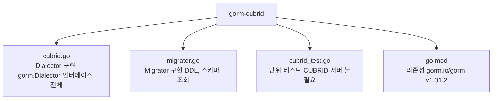

# CLAUDE.md — gorm-cubrid 개발 컨텍스트

공통 작업·리뷰·이슈 규칙은 [AGENTS.md](AGENTS.md)를 따릅니다. 이 파일은 Claude Code용 참고 컨텍스트이며 별도의 브랜치, 리뷰어 또는 승인 절차를 요구하지 않습니다.

## 프로젝트 개요

GitHub 저장소 `cubrid-lab/gorm-cubrid` (Go module 경로 `github.com/cubrid-labs/gorm-cubrid`)는 [GORM](https://gorm.io/) ORM의 CUBRID 데이터베이스 드라이버입니다.
`gorm.Dialector` 인터페이스를 구현하며, CUBRID 11.2+ 를 대상으로 합니다.

## 파일 구조



## 아키텍처

### Dialector (`cubrid.go`)

| 메서드 | 역할 |
|---|---|
| `Open(dsn)` / `New(config)` | 생성자 |
| `Initialize(db)` | 연결 풀 설정, 콜백 등록, Ping 검증 |
| `DataTypeOf(field)` | Go 타입 → CUBRID SQL 타입 변환 |
| `BindVarTo(...)` | `?` 플레이스홀더 (MySQL 호환) |
| `QuoteTo(...)` | 백틱 `` ` `` 식별자 쿼팅 |
| `Explain(...)` | 로깅용 SQL 포맷 |

### Migrator (`migrator.go`)

`migrator.Migrator`를 임베드하고 CUBRID 비호환 메서드를 오버라이드합니다.

**오버라이드 이유:**
- `RenameTable` — CUBRID는 `ALTER TABLE RENAME TO` 미지원, `RENAME TABLE old TO new` 사용
- `DropIndex` — CUBRID는 `ON table` 필수: `DROP INDEX idx ON table`
- `AlterColumn` — CUBRID는 `MODIFY COLUMN` 사용 (베이스는 PostgreSQL 스타일 `ALTER COLUMN TYPE`)

**스키마 조회 방식:**
- `HasTable`, `HasColumn`, `ColumnTypes` → `INFORMATION_SCHEMA` (CUBRID 11.2+)
- `HasIndex` → `db_index` 시스템 카탈로그 (INFORMATION_SCHEMA에 statistics 없음)

## CUBRID 특이사항 (코드 작성 시 주의)

1. **Unsigned 타입 없음** — `uint*`는 동일 크기 signed 타입으로 매핑 (`uint32` → `int`)
2. **RETURNING 미지원** — `callbacks.Config{}`에서 WithReturning 사용 금지
3. **데이터 타입 이름** — `tinyint(1)` (bool), `clob` (large string), `blob` (bytes)
4. **AUTO_INCREMENT** — MySQL과 동일한 컬럼 속성 문법 지원
5. **식별자 쿼팅** — 백틱 `` ` `` 사용 (MySQL 호환), 이중 백틱으로 이스케이프
6. **문자열 크기 경계** — `size >= 65536` → `CLOB`, 미만 → `VARCHAR(n)`
7. **테이블명 대소문자** — CUBRID는 테이블명을 소문자로 저장, 조회 시 `strings.ToLower` 적용

## 개발 명령어

```bash
# 빌드
go build ./...

# 단위 테스트 (서버 불필요, 빠름)
go test ./...

# 상세 출력
go test -v ./...

# 특정 테스트만
go test -run TestDataTypeOf ./...

# 정적 분석
go vet ./...
```

## 테스트 전략

- **단위 테스트** (`cubrid_test.go`): CUBRID 서버 없이 실행 가능. `DataTypeOf`, `QuoteTo`,
  `BindVarTo`, `Explain`, `buildColumnType` 등 순수 로직 커버.
- **통합 테스트 상태**: 현재 저장소에는 `//go:build integration` 태그가 붙은 테스트 파일이 없습니다. `.github/workflows/ci.yml`에는 CUBRID 11.3 서비스를 사용하는 push 전용 integration job이 있지만, 그 job이 현재 실제 DB 시나리오를 검증한다고 주장하지 마세요. 실제 `AutoMigrate`, CRUD, `HasTable` 동작은 아직 검증된 것으로 간주할 수 없습니다.

## 의존성

| 패키지 | 역할 |
|---|---|
| `gorm.io/gorm v1.31.2` | GORM 코어 |
| `github.com/cubrid-labs/cubrid-go` | CUBRID SQL driver (pure Go, no CGO) |

> `github.com/cubrid-labs/cubrid-go` is a pure Go SQL driver registered as "cubrid".
>{
> It is imported as:
> `import _ "github.com/cubrid-labs/cubrid-go"`

## 브랜치 전략

- 작업 브랜치는 현재 기본 브랜치에서 작업 목적에 맞게 생성합니다. 특정 Claude 전용 브랜치를 강제하지 않습니다.
- 커밋 메시지 형식은 [CONTRIBUTING.md](CONTRIBUTING.md#commit-messages)와 저장소의 기존 규칙을 따릅니다.
- 사람과 모든 코딩 에이전트는 동일한 검토 기준을 적용받습니다. AI 리뷰는 참고용이며 필수 승인 절차가 아닙니다.
